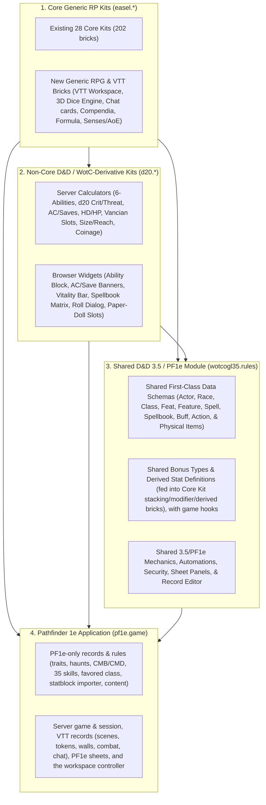

# Pathfinder 1e on Easel — Architectural Proposal

## Overview

This proposal outlines what is required to build a complete **Pathfinder 1e (PF1e)** implementation on **Easel** using Easel's **Lego Construction** philosophy rather than a direct port of Foundry VTT's monolithic document/client architecture.

To maximize reuse across genres and game families while keeping packages modular, lazy-loaded, and server-authoritative, the architecture is split across **four distinct tiers of concern**:

---

## Concern 1: Core Generic RP Kits (`server/easel/server/library/`)

**Scope:** Stateless, lazy-loaded server calculators and browser UI components (`type: "kit"`) useful across *any* tabletop RPG (GURPS, Blades in the Dark, Call of Cthulhu, Shadowrun, Savage Worlds, Fate, D&D, Pathfinder, etc.).
**Rules:** No database schemas (`data`), no automations, no security policies, and no startup side effects. Importing a catalog loads zero member files until a specific brick is requested.

### 1.1 Existing Core Kit Bricks We Will Use Directly
From the 28 existing Core Kits ([`server/easel/server/library/catalog.json`](../Easel/server/easel/server/library/catalog.json)):
- **Layout & Shell (`easel.layout`)**: `window@1`, `tabs@1`, `panel@1`, `dialog@1`, `split@1`, `sheet@1`
- **Input & Interaction (`easel.input`)**: `selection@1`, `dragdrop@1`, `contextmenu@1`, `targetpicker@1`, `shortcut@1`, `popover@1`
- **Display (`easel.display`)**: `portrait@1`, `badge@1`, `tooltip@1`, `notification@1`, `image@1`, `label@1`
- **Dice (`easel.dice`)**: `roller@1` (backed by Go's cryptographic `Easel.Random`), `notation@1`, `pool@1`, `results@1`, `tray@1`
- **Characters & Progression (`easel.characters`, `easel.progression`)**: `attributes@1`, `skills@1`, `traits@1`, `derived@1`, `skilllist@1`, `traitlist@1`, `tree@1`, `budget@1`, `pointbuy@1`
- **Combat & Turns (`easel.combat`, `easel.turns`)**: `initiative@1`, `attack@1`, `damage@1`, `range@1`, `encounter@1`, `target@1`, `sequence@1`, `phase@1`, `turnorder@1`
- **Rules & Effects (`easel.rules`, `easel.effects`)**: `predicate@1`, `modifier@1`, `threshold@1`, `lookup@1`, `modifierlist@1`, `duration@1`, `stacking@1`, `status@1`, `effectlist@1`
- **Inventory, Resources & Economy (`easel.inventory`, `easel.resources`, `easel.economy`)**: `capacity@1`, `equipment@1`, `container@1`, `inventory@1`, `item@1`, `pool@1`, `cost@1`, `exchange@1`, `price@1`
- **Maps, Surfaces & Visibility (`easel.maps`, `easel.surfaces`, `easel.pieces`, `easel.visibility`)**: `map@1`, `ruler@1`, `fog@1`, `vision@1`, `geometry@1`, `squaregrid@1`, `camera@1`, `token@1`, `projection@1`, `disclosure@1`, `concealed@1`
- **Collections, Narrative & Tables (`easel.collections`, `easel.narrative`, `easel.tables`)**: `ordered@1`, `set@1`, `transfer@1`, `browser@1`, `journal@1`, `handout@1`, `rolltable@1`

### 1.2 New Core Generic RP Bricks Needed
To support rich VTT roleplaying across all RPG genres, the following generic bricks should be added to the Core Kits:

| Target Core Kit | Proposed Brick | Side | Responsibility |
|---|---|---|---|
| `easel.layout` | `vttworkspace@1` | Client | Standard VTT screen layout shell with named slots for `canvas` (background battlemap), `tools` (left scene/layer toolstrip), `hud` (floating token HUD), `hotbar` (bottom macro/quick-action bar), `sidebar` (right collapsible tabbed dock), and `windows` (floating movable sheets/dialogs). Useful for any VTT RPG. |
| `easel.layout` | `toolstrip@1` | Client | Vertical/horizontal scene & tool control bar (e.g., Token Select, Measure Ruler, AoE Template, Lighting, Walls, Journal Pins) emitting tool-change intents. |
| `easel.collections` | `directory@1` | Client | Hierarchical folder & entity tree with search, create/folder buttons, drag-source support, and context menu requests (reusable for Actors, Items, Journals, Scenes, or Tables in any RPG). |
| `easel.effects` | `stacking@1` *(refine in-place)* | Server | Refine [`stacking@1`](../Easel/server/easel/server/library/effects/server/stacking.mjs) directly (since Easel is in alpha) to accept per-key policies (e.g., `strongest` vs. `stack` by bonus type, plus separate handling for positive bonuses vs. negative penalties) alongside single-policy calls. |
| `easel.characters` | `derived@1` *(refine in-place)* | Server | Refine [`derived@1`](../Easel/server/easel/server/library/characters/server/derived.mjs) in-place to support formula/modifier evaluation across the topological dependency graph while preserving per-stat source breakdowns. |
| `easel.rules` | `formula@1` | Server | Safe deterministic expression parser & evaluator supporting `@path` variable substitution, `floor`, `ceil`, `round`, `min`, `max`, `clamp`, `abs`, and conditional ternaries against a caller-supplied context object. |
| `easel.narrative` | `chatlog@1` | Client | Scrolling RPG message/event stream supporting speaker headers, whisper/blind badges, collapsible sections, and slotted action/roll cards. |
| `easel.dice` | `dicebox@1` | Client | 3D physics-animated polyhedral dice overlay (*Dice So Nice!* equivalent: `d4`, `d6`, `d8`, `d10`, `d100`, `d12`, `d20`, `d2`) with customizable textures, materials, colorsets, special effects, and collision SFX that deterministically land on the server-authoritative `easel.dice.roller@1` outcomes and emit `settled` events to synchronize chat card reveals. |
| `easel.dice` | `dicesettings@1` | Client | Player & GM 3D dice customization widget (preset themes, colorsets, textures, materials, font, throw force, sound volume, and live 3D preview) emitting preference-save intents. |
| `easel.dice` | `rollcard@1` | Client | Expandable dice roll card component showing formula, total, critical/fumble highlight state, individual die faces, and a collapsible breakdown of contributing modifiers (`easel.rules.modifierlist@1`). |
| `easel.narrative` | `richtext@1` | Client | Rich-text viewer/editor with support for inline clickable enricher pills (e.g., inline roll requests, condition references, or compulsion/save links) and dual public/secret blocks. |
| `easel.maps` | `template@1` | Server & Client | Generic geometric area-of-effect calculators and canvas overlays for cones, circles/bursts, lines/rays, and rectangles on grid or freeform maps, returning covered cells/tokens. |
| `easel.maps` | `map@1` & `geometry@1` *(refine in-place with `easel.graphics.pixi@1`)* | Server & Client | **PixiJS Multi-Level Layered Battlemap & Wall Collision** (evolving [`_Easel/Praxis/modules/rpgkit/0.1.0/client/battlemap.js`](../_Easel/Praxis/modules/rpgkit/0.1.0/client/battlemap.js)): HTTP client requires `easel.graphics.pixi@1` (PixiJS v8 WebGL/WebGPU) instead of the legacy Godot WASM bridge. Renders the `ground` level stack (independent pixel grid, `relativesize` scale, 2-click **Line up grid** calibration, `height`, `alphaMask` revealing lower ground art with depth shading, and `.map` zip import/export) and its 6 child layer types (`object`, `drawing`, `wall` segments/clickable `door`s/circular `column`s, `token`, `light`, and smooth-fading `roof` polygons). Enforces `movementBlocked` with the **80% token body radius** (`0.4 * min(w, h)`) doorway rule both on the server and as a live client drag preview. |
| `easel.maps` | `vision@1` & `fog@1` *(refine in-place with `easel.graphics.pixi@1`)* | Server & Client | **Hybrid Server-Authorized + PixiJS GPU Vision & Hindrance Engine** (evolving [`_Easel/Praxis/modules/rpgkit/0.1.0/vision.js`](../_Easel/Praxis/modules/rpgkit/0.1.0/vision.js)): Server runs the `VisionRegistry` (`hindrances`, `presets`, `range: {depth, maximum}`, `luminance`, `transformation: {saturation}`, `hindered: {[material]: 0..1}`), directional `angle` visibility, compounding effective distance (`multiplier /= 1 - hindrance`), and 9-point footprint check as the **security boundary** (never sending unseen tokens). Instead of a coarse 128px bitmap, the `http-entry` uses PixiJS `RenderTexture`s and GPU shaders (`ColorMatrixFilter` for `saturation: 0` darkvision, radial smoothstep falloff, crisp vector wall/column shadows, and persistent explored Fog of War). |
| `easel.visibility` | `projection@1` *(refine in-place from `_Easel`)* | Server | Pre-filter viewer-specific **Token Presentation & Illusion Hook** (`TokenDraw` & `InvalidatePresentation` from [`_Easel/Praxis/modules/rpgkit/0.1.0/VISION.md`](../_Easel/Praxis/modules/rpgkit/0.1.0/VISION.md)): lets game rules override a token's `presentation: {opacity, luminance, types}` per viewer *before* visibility filtering (so a believed illusion token with `types: ['wall']` blocks sight, while a disbelieved illusion returns `{opacity: 0.25, types: []}` to remove obstruction only for that viewer). Caches per `(map, revision, viewer)`, strips `visionMask`/`presentation` on save, and emits viewer-specific deltas on invalidation. |
| `easel.maps` | `shadowbox@1` & `worldmap@1` | Server & Client | **PixiJS Theater-of-the-Mind Stage & World Map** (from [`_Easel/docs/RPGKIT_INTERFACES.md`](../_Easel/docs/RPGKIT_INTERFACES.md)): `shadowbox@1` renders a 16:9 PixiJS scene tree with groups, image filters (tint, saturation, contrast, luminance, chroma-key transparency), `Speak` dialogue boxes, GM `ToggleElements`, and `.box` zip archives; `worldmap@1` renders pan/zoom overland tile maps with linked location pins. |
| `easel.collections` | `compendium@1` | Client | Virtualized, categorized, searchable reference browser with tag filter pills, drag-source payloads, and quick-inspect preview slots. |
| `easel.resources` | `charges@1` | Server | Generic charge/use tracker supporting per-use cost, per-day/per-scene/per-rest recovery policies, and recharge formulas. |

---

## Concern 1A: VTT Module (`vtt.table`)

**Scope:** A regular module (`easel.vtt.table`, at `modules/vtt/`, required by the games that use it, records published as `easel.vtt.<Type>`) holding the virtual-tabletop records and server behavior any tabletop game uses: scenes, tokens, walls and doors, fog of war, combat turn order, chat with roll modes, journals, folders, and per-user dice settings. Kits cannot hold records, and none of this is Pathfinder or 3.5 rules, so it is neither a Kit nor part of the d20 packages. Games plug in their rules through hooks (actor resolution, initiative, vision presets, distance metric, roll cards). Detail: [03A-VTT-Module-Scenes-Tokens-Combat-Chat.md](03A-VTT-Module-Scenes-Tokens-Combat-Chat.md).

---

## Concern 2: Non-Core D&D / WotC-Derivative Kit (`d20`)

**Scope:** A standalone, **non-core Kit package** (e.g., `easel.d20.kit` under host `d20`) containing stateless server calculators and reusable UI widgets shared by any **D&D / WotC-derivative RPG** (OD&D, AD&D, D&D 3.0/3.5, Pathfinder 1e, Pathfinder 2e, D&D 4e, D&D 5e, Starfinder, 13th Age, d20 Modern, OSR).
**Rules:** Still a pure Kit (`type: "kit"`). It does **not** lock in PF1e's specific 35 skills or 21 bonus types; instead, it provides the classic D&D building blocks that any d20/WotC derivative snaps together.

### 2.1 Server Interface Bricks (`easel.d20.*`)
- **`easel.d20.abilities@1`**:
  - Standard six ability scores (`str`, `dex`, `con`, `int`, `wis`, `cha`), standard modifier formula `floor((score - 10) / 2)`, ability point-buy cost calculators, and ability check evaluation.
- **`easel.d20.check@1`**:
  - Core `1d20 + modifiers` resolution against a target DC or AC; handles natural 1 / natural 20 rules, critical threat range detection (`20`, `19-20`, `18-20`, `15-20`), critical confirmation rolls, and critical damage multipliers (`x2`, `x3`, `x4`).
- **`easel.d20.defense@1`**:
  - Armor Class (AC) and Saving Throw calculators supporting multiple AC profiles (Normal, Touch, Flat-Footed) and standard saving throw progressions (Fortitude/Reflex/Will or 6-ability saves).
- **`easel.d20.health@1`**:
  - Hit Dice (`d4`–`d12`) + ability modifier per level calculation, Temporary HP absorption buffer, Nonlethal damage staging, and threshold state detection (Normal, Staggered/Disabled, Unconscious/Dying, Dead).
- **`easel.d20.spellbook@1`**:
  - Vancian prepared spell slots, spontaneous daily spell cast counters, hybrid (Arcanist-style) preparation, cantrips/orisons (`0-level`), bonus spell slots from high ability scores, Spell DC (`10 + spellLevel + abilityMod + bonuses`), and Concentration / Caster Level check math.
- **`easel.d20.size@1`**:
  - Creature & object size scale (Fine, Diminutive, Tiny, Small, Medium, Large, Huge, Gargantuan, Colossal), space/footprint on a 5-ft grid, natural reach (tall vs. long), and size-based weapon dice stepping.
- **`easel.d20.damagetypes@1`**:
  - Multi-part damage packet resolver handling physical types (`bludgeoning`, `piercing`, `slashing`), energy types (`acid`, `cold`, `electricity`, `fire`, `sonic`, `force`, `positive`, `negative`), alignment/material qualifiers (`magic`, `silver`, `coldIron`, `adamantine`, `lawful`, `chaotic`, `good`, `evil`), Damage Reduction (DR), Energy Resistance (ER), Immunities, and Vulnerabilities (+50%).
- **`easel.d20.grid@1`**:
  - 5-foot square tactical grid math: alternating `5-10-5-10` diagonal distance measurement, 5-ft step validation, flanking geometry detection, and d20 burst/emanation/cone/line template cell selection.
- **`easel.d20.currency@1`**:
  - Standard `PP / GP / SP / CP` denomination conversion, coin weight calculation (50 coins = 1 lb), and transaction/split helpers.

### 2.2 Browser Component Bricks (`easel.d20.*`)
- **`easel.d20.abilityblock@1`**: Six-ability score strip/table showing Base, Total, Modifier, Temp/Penalty indicators, and 1-click Ability Check roll events.
- **`easel.d20.defensebanner@1`**: Compact AC display (Normal, Touch, Flat-Footed) and Saving Throw strip (Fortitude, Reflex, Will) with hover breakdown tooltips and roll events.
- **`easel.d20.vitality@1`**: Hit Points, Temporary HP, Nonlethal HP, Wounds/Vigor optional display, and quick Damage / Heal / Rest intent controls.
- **`easel.d20.spellbook@1`**: Level `0–9` spellbook manager with preparation checkboxes, spontaneous cast pips, domain/school slot indicators, Caster Level / Concentration header, and Cast/Prepare events.
- **`easel.d20.attackcard@1`**: Rich chat card for d20 attacks displaying iterative attack rolls, critical threat/confirmation rolls, multi-type damage breakdowns, save DCs, range, ammo consumed, and inline "Apply Damage / Roll Save" buttons.
- **`easel.d20.rolldialog@1`**: Pre-roll situational modifier prompt (Normal / Take 10 / Take 20, situational bonus/penalty input, conditional toggles like Flanking / Haste / Power Attack, and Roll Mode selector).
- **`easel.d20.equipmentslots@1`**: Humanoid magic item body-slot paper doll / table (`head`, `headband`, `eyes`, `shoulders`, `neck`, `chest`, `body`, `armor`, `belt`, `wrists`, `hands`, `ring`, `feet`, `slotless`).

---

## Concern 3: Shared D&D 3.5 / Pathfinder 1e Module (`wotcogl35.rules`)

**Scope:** A **Module** (`type: "module"`, `easel.wotcogl35.rules`, records published as `easel.wotcogl35.<Type>`) shared by a D&D 3.5 application and the PF1e application. A piece belongs here only if it also holds under D&D 3.5 rules.

**Responsibilities:**
- **First-class record types**: `Actor` (`Character`, `NPC`, `Trap`), `Race`, `Class`, `ClassLevel`, `Feature` (`Feat`, `ClassFeature`, `RacialTrait`), `Spellbook`, `Spell`, `Buff`, `Action`, and physical `Item` (`Weapon`, `Armor`, `Shield`, `WondrousItem`, `Consumable`, `Container`, `Loot`). Foundry stuffed races, classes, feats, spells, and buffs into `Item`; Easel does not have that limitation. Detail: [05-WOTCOGL35-Module-Schemas-And-Security.md](05-WOTCOGL35-Module-Schemas-And-Security.md).
- **Shared rules**: the bonus types shared by both games (fed into Core `easel.effects.stacking@1`), the derived-stat graph (fed into `easel.characters.derived@1`), ability modifiers, BAB and save progressions, HP, AC, iterative/two-weapon/natural attacks, shared conditions, encumbrance and armor limits, Vancian spellcasting, and sense presets with illusion disbelief. Values that differ between the games (skill list, death threshold, concentration, maneuvers) come from **record-layer hooks** the game overrides. Detail: [06-WOTCOGL35-Module-Rules-Layers-And-Automations.md](06-WOTCOGL35-Module-Rules-Layers-And-Automations.md).
- **Automations**: `wotcogl35.ApplyDamage`, `SpendActionUses`, `Rest`, `AdvanceTurn`, `TransferItem`, `TransferCoin`.
- **Security**: ownership, observers, GM notes, and unidentified-item stripping.
- **Shared client panels**: abilities, inventory, features, spellbooks, buffs, and the record editor, which a game's sheets mount.

Reusing Core Kit bricks is mandatory here: the module supplies rule *data* to `easel.effects.stacking@1`, `easel.rules.modifier@1`, `easel.characters.derived@1`, and `easel.rules.formula@1` rather than writing its own pipeline. Refine those `@1` bricks in place when they need more; do not create `@2` versions during alpha.

---

## Concern 4: The Pathfinder 1e Application (`pf1e.game`)

**Scope:** The game itself (`type: "application"`, `easel.pf1e.game`). Per [`Easel/design/manifest.md`](../Easel/design/manifest.md#L124), an application "owns the game's rules, wiring and persistence." **It is not a thin wrapper**, and it does not follow the 1–3 line `applications/chess` pattern; [`applications/mtgtable`](../Easel/server/easel/applications/mtgtable/manifest.json) is the better model. It is still built Lego-style from Kit bricks and the shared module, and anything specific to Pathfinder lives here.

**Responsibilities:**
- **PF1e-only records and rules**: `Trait`, `Haunt`, `Vehicle`, `Implant`; `.modify` additions to shared types (favored class bonus, CMB/CMD settings, wounds & vigor, background skills, flexible racial ability bonus, spell points); PF1e record layers (35 skills with the `+3` class skill bonus, `trait` bonus type, CMB/CMD and maneuvers, death at negative Con, PF1e concentration, favored class); PF1e automations; the Paizo statblock importer; PF1e content and compendium. Detail: [07-PF1E-Application-Rules-And-Records.md](07-PF1E-Application-Rules-And-Records.md).
- **The game as played**: server game and session (honest server-side rolls, roll modes, GM roles, per-viewer projection), VTT records (`Scene`, `Token`, `Wall`, `Combat`, `Combatant`, `ChatMessage`, `JournalEntry`, `Folder`, `DiceSettings`), the 11-tab character sheet, the NPC sheet, and the workspace controller that wires the map, combat tracker, chat, dice, directories, and compendium. Detail: [08-PF1E-Application-Game-Sheets-And-Workspace.md](08-PF1E-Application-Game-Sheets-And-Workspace.md).
