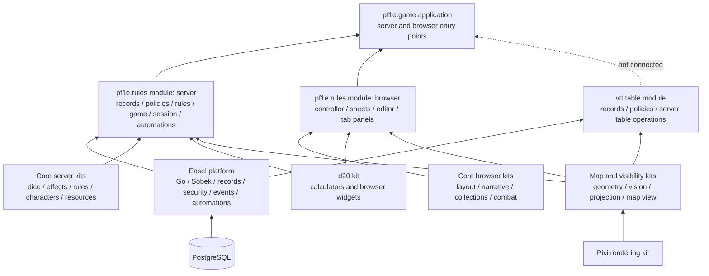
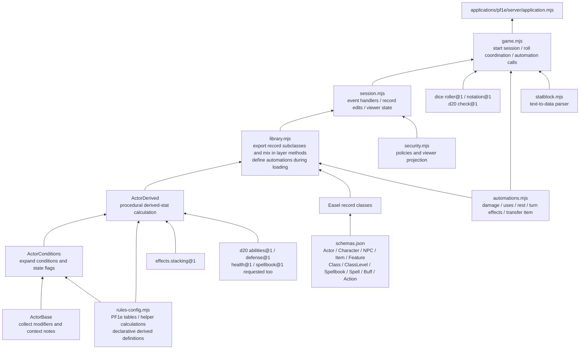
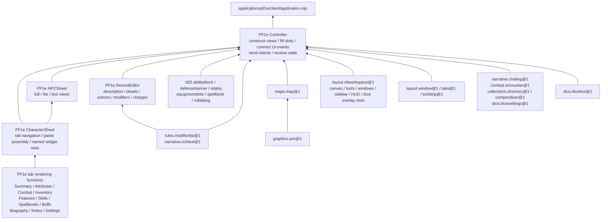
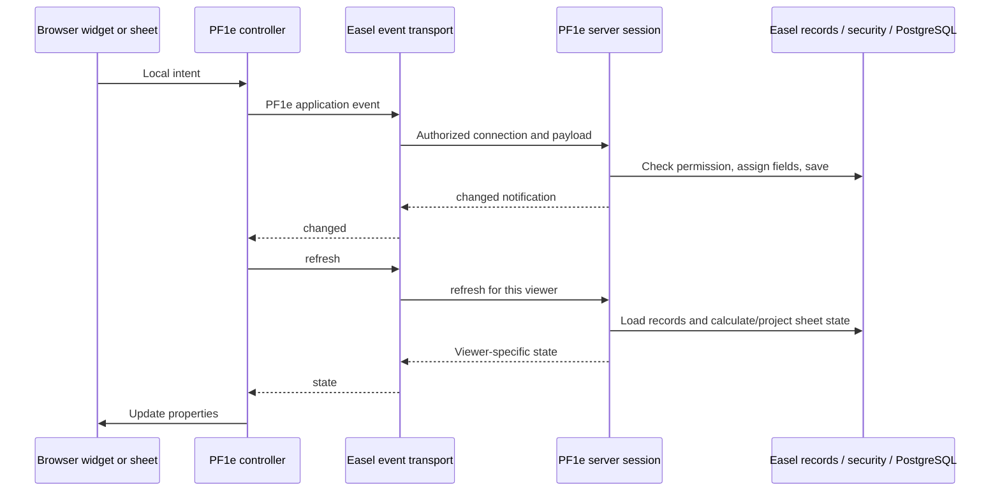
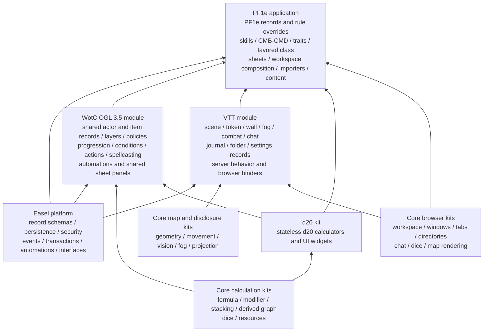

# PF1e component graph

The diagrams below record the structure before VTT integration. For the updated graph, Actor inheritance, interaction roles and live bindings, see [the current integration document](Easel/design/pf1e-vtt.md).

This is an editable architecture map, not an implementation plan. Current graphs describe the source inspected on October 29, 2026. The final graph describes the existing requirements, not an approved replacement architecture.

Arrows run from a provider to its consumer: `A --> B` means B is built using A. Dashed arrows describe intended connections that do not currently exist. Grouped boxes collect related interfaces; they do not imply one implementation or dependency between every member. Runtime flows are explicitly labeled separately.

## 1. Current package structure

The platform provides runtime and persistence services; it is not another gameplay kit. Core kits are independently selectable tools. The d20 kit is also a set of independent tools, not a runtime that owns the game. Most PF1e behavior currently lives in the module rather than the application.

Locations relative to `Easel/server/easel/`:

| Box | Source |
|---|---|
| Core kits | `server/library/<kit>/` |
| d20 | `server/library/d20/` |
| Pixi | `modules/pixi/` |
| PF1e server/browser module | `modules/pf1e/` |
| VTT server module | `modules/vtt/` |
| PF1e application | `applications/pf1e/` |

## 2. Current server construction

Important qualifications:

- `ActorDerived` requests health and spellbook tools but does not actually use those tool instances to build its returned derived state.
- `characters.derived@1` exists in the core library, but the current actor calculation does not run through it. The declarative definitions and procedural calculation are separate paths.
- The graph shows construction, not a clean separation of responsibilities. Game and Session also call one another at runtime.
- Statblock parsing is present; live import into saved actor/child records is not connected.
- Items have a parallel physical-layer branch: `ItemPhysical`, `WeaponPhysical`, `ArmorPhysical`, mixed into exported record classes by `library.mjs`.

## 3. Current browser composition

The controller creates many of the widgets and attaches them to slots exposed by the sheet. The sheet does not independently build all of its contents. Character tab navigation is handwritten in `charactersheet.mjs` despite the manifest requiring the generic tabs interface. The directory currently opens the character-sheet route for every actor; a separate NPC route exists in the controller but is not selected there.

Map, encounter and compendium components are mounted, but mounting does not establish saved scenes, combat behavior or content loading. Several sheet events have no controller listener; several controller requests have no registered server handler.

## 4. Current record-edit runtime flow

This diagram uses arrows for execution/data flow, not dependency direction.

The reusable widget emits an intent; the controller connects it to the application's server event. Browser widgets should not directly persist game records. Current PF1e refresh rebuilds actor/child state, rather than delivering incremental record updates.

## 5. Structure described by the existing requirements

This is a design under discussion. It is not the current implementation and is not a request to approve it unchanged.

Dependencies on a grouped kit box mean selected tools as needed, not that every interface depends on every other tool. VTT and shared rules are sibling modules. The application composes them and supplies actor, initiative, movement and visibility hooks; VTT should not import PF1e rules. The exact owner of each adapter is still a design choice.

| Tier | Owns | Does not own |
|---|---|---|
| Platform | Runtime, schema enforcement, storage, permission engine, transaction and event infrastructure | Pathfinder rules |
| Core server kit | Pure calculations over supplied values | Record loading/saving, game ownership or networking |
| Core browser kit | Rendering, local interaction and declared UI events | Authoritative game state or persistence |
| d20 kit | Reusable d20 math and widgets | Campaign records or the game session |
| VTT module | Persistent tabletop entities and their behavior | Pathfinder-specific character rules |
| Shared rules module | Shared 3.5/PF1e records, mechanics, mutations and panels | PF1e-only differences or workspace layout |
| PF1e application | Game-specific rules, records, presentation and composition | Generic tools already owned below it |

## 6. Boundaries available to rearrange

- Whether to introduce the shared 3.5 module now, or keep PF1e rules in the application until another game needs them. The existing requirements choose the shared module; the current implementation has neither that split nor application ownership.
- Whether character calculations should be composed from record layers, a declarative derived graph, or layers that supply inputs/configuration to one graph. Avoid two independent authoritative calculations for the same statistic.
- Whether shared panels belong in the rules module or a separate presentation package. Pure generic widgets should remain in kits either way.
- Where the application-to-VTT adapters live and exactly what actor, initiative, vision and turn-effect contracts they expose.
- Whether content importing is a separate component from content storage/browsing. Text parsing, validated record creation, pack management and drag-and-drop are distinct responsibilities.

These are architectural choices to settle bottom up before adding more features. No source code or requirement files were changed to impose an answer.
