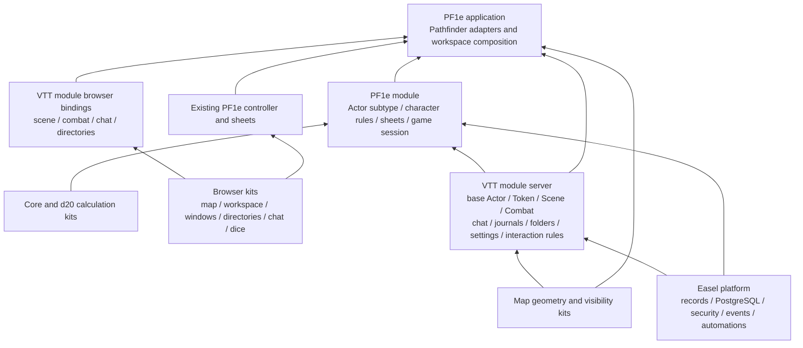
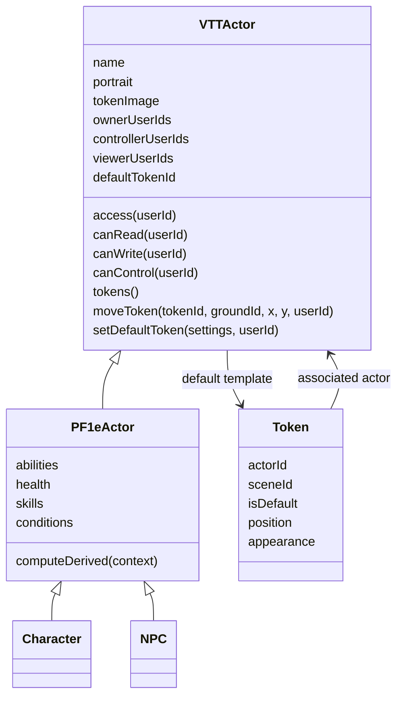

# Pathfinder and VTT integration

The Pathfinder application now requires and starts `easel.vtt.table`. Its server entry supplies Pathfinder adapters, while its client entry composes the VTT bindings with the existing Pathfinder controller. The older PF1e rules module still contains the sheets and rules; the larger shared 3.5/PF1e package split has not been performed.

## Ownership and dependencies

Arrows point from a provider to what uses it.



## Actor inheritance and interaction roles



`easel.pf1e.Actor` declares `.extends: "easel.vtt.Actor"`. The shared identity and interaction fields belong to the VTT module. The PF1e subtype supplies game rules. A token's `actorId` is a typed reference to the base Actor and therefore accepts a Pathfinder subtype. The inherited record methods run on those subtypes too.

The current role design uses arrays, so each actor may have multiple users in each role:

| Role | Read actor | Write actor/default token | Control tokens and roll | Manage actor access lists |
|---|---|---|---|---|
| Owner | Yes | Yes | Yes | Yes |
| Controller | Yes | No | Yes | No |
| Viewer | Yes | No | No | No |
| GM | Yes | Yes | Yes | Yes |

These actor roles are game settings evaluated by `modules/vtt/server/interaction.mjs`. They are separate from the platform's GM/player/spectator record policies. Client events use the authenticated connection's user ID. Token and combatant access is resolved from the actor when used, so changing roles does not require copying permissions into token records.

The default token is an unplaced `easel.vtt.Token` with `isDefault: true` and no scene. Placing the actor copies its appearance and dimensions into a new scene token. Template records are excluded from scene rendering and combat.

## Runtime connections

- `applications/pf1e/server/application.mjs` starts the existing PF1e game with the VTT table and a roll publisher.
- `applications/pf1e/server/table.mjs` supplies actor metadata, authoritative initiative calculations, Pathfinder vision presets, dice chat commands and roll cards. It connects turn events to the existing turn-effect automation.
- `modules/vtt/client/scenebinder.mjs` binds projected scenes to the map, token movement, actor drops, door requests, map edits and grid calibration. Camera changes remain local.
- `modules/vtt/client/combatbinder.mjs` binds encounter creation, token participation, initiative, defeated states and turn progression to the combat widget.
- `modules/vtt/client/chatbinder.mjs` binds public/GM/blind/self messages, per-user dice settings, and roll animations. A concealed blind card is neither rendered nor animated. New visible roll cards wait for their dice to settle; loading chat history does not replay old rolls.
- `modules/vtt/client/directorybinder.mjs` binds scene and journal directories, their settings windows, actor access lists and default-token editing using the existing UI kits.
- `applications/pf1e/client/table.mjs` assembles these bindings and connects Apply Damage to the actor on the selected target token.

Existing PF1e chat records remain available as history. New messages and roll cards use VTT records. Private game rolls are published through the table's per-viewer message projection rather than the previous public roll-result broadcast.

The table strips calculated presentation/mask values before saving a map. Pathfinder computes visibility on the server with the existing projection kit and sends the projected token list and mask to the map view.

Bindings avoid rebuilding an unchanged map, combat list or chat stream on unrelated refreshes. This preserves camera gestures and prevents an incoming state refresh from replacing a button between pointer-down and click.

## Verification

```powershell
node --test scripts/test-client.mjs scripts/test-kits.mjs scripts/test-vtt-bindings.mjs
./scripts/test-security.ps1
$env:EASEL_PLAYWRIGHT_MODULE = (Resolve-Path node_modules/playwright/index.mjs).Path
./scripts/test-security.ps1 -Run 'Pathfinder|VTT'
```

The browser test runs against an isolated temporary PostgreSQL cluster. It covers two users, scene settings, actor drops, default-token copying, actor roles, movement and wall blocking, fog filtering, combat initiative/turns, targeted damage, journals, private messages and saved dice settings. A test-only HTTP handler stops and starts the Pathfinder game runtime, then the browser reloads and checks the saved scene, tokens, combat and template. This handler exists only in `internal/server/pf1e_test.go`; it is not a production endpoint.

## Remaining scope

This integration does not complete the PF1e rules engine, leveling, spell preparation, statblock import, compendium content, full map authoring tools, persistent explored fog or multi-page journals. The reusable VTT module is now part of the running application rather than an isolated backend. Its stored state and interaction boundaries can be developed independently of those remaining game rules.
